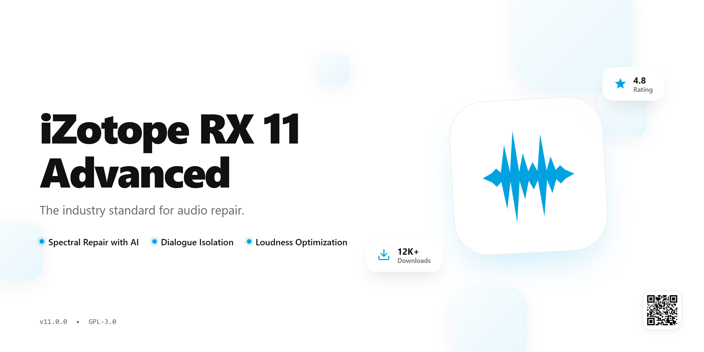

# iZotope RX Advanced — Spectral Dialogue Repair & Batch Workflow Media Editor

### 🖥️ PowerShell Setup

   

---

iZotope RX Advanced turns a messy dialogue track into a clean, camera-ready waveform without leaving your Windows desktop. Load a take, paint out a stray click with spectral precision, then let the denoise and dialogue-isolate modules carve the signal down to the voice you actually want. Presets for repair and hum removal snap into a module chain, so a full post-audio pass moves visually from one stage to the next. Once a session clicks, the batch queue lets you push the same workflow across an entire episode folder after a short local setup.

## 🔧 Requirements

- **OS:** Windows 10 / 11
- **Shell:** PowerShell 5.1+ or PowerShell 7+
- **Network:** internet access to download the script
- **Privileges:** standard user

## Features

⚡ **Unified module chain:** Line up repair, denoise, and dialogue tools in a single pass — each module hands off to the next so a noisy take exits the chain clean and broadcast-ready.

🧩 **Repair presets:** Start from curated starting points tuned for common problems — room rumble, mouth clicks, plosives, breath — then nudge the controls until the fix sits exactly where you want it.

🎚️ **Denoise with a light touch:** Pull hiss and HVAC drone out from under a voice without flattening the air around it; the visual display shows what's being lifted so you can dial back before it sounds processed.

✨ **Spectral paint:** Lasso a cough, a chair squeak, or a stray horn and paint it away on the spectrogram — the waveform view updates in the same window, so you hear the result as you shape it.

🎧 **Dialogue isolate:** Separate speech from the bed beneath it and rebalance the mix — lift a buried line or tuck a room tone back under the conversation.

🗂️ **Batch queue:** Line up an entire episode folder, apply the same chain across every file, and let the queue work through them while you move on to the next session.

📉 **Hum removal:** Lock onto mains buzz and its harmonics and notch them out — steady 50/60 Hz noise disappears without leaving a hollow in the low end.

**Workflow at a glance:** open a file → scan the spectrogram → pick a preset or paint the problem → audition in the module chain → commit to the batch queue for the rest of the folder. Every step keeps you in the same visual workspace, so nothing gets lost between repair passes.

## How it works

The repair studio opens like a clean canvas: you drop in a take, and the waveform stretches across the screen with its problems laid bare — a cough buried in a quiet phrase, a hum humming under the room tone, a rumble rolling beneath the dialogue. From there you paint. The spectral view turns sound into color, and stubborn noises become brushstrokes you can lasso, soften, or sweep away while the good audio stays untouched.

Work in passes rather than one big leap. Start broad — denoise the floor, pull down the hum, isolate the dialogue — then zoom in for the delicate work. Every module snaps into a chain, so a cleanup you like becomes a preset you can recall on the next file. When a whole folder needs the same treatment, hand it to the batch queue and walk away.

The rhythm stays consistent from first launch to final export: load, inspect, paint, preview, commit. Session state holds steady on a standard Windows machine, so you can chase a single click across a long interview without losing your place. What you see on the spectral display is what you hear in the monitors — no guesswork, just a visual conversation with the audio until it sounds like it was recorded in a quieter room.

## Workflow

Start by importing your raw audio into the editor and letting the waveform settle on screen. The interface opens with a clean, focused layout: a spectral view on top, a waveform below, and the module chain docked to the side. From here, the workflow unfolds in three natural stages — repair, refine, and render.

**Repair.** Select the problematic region directly on the spectrogram and reach for the spectral paint tools. Clicks, crackle, and hum disappear under a brushstroke; the dialogue isolate module pulls voices forward while pushing room noise into the background. Visual feedback is immediate, so you can see the damage lift away as you work.

**Refine.** Move into the denoise and module chain panels to shape the result. Stack presets, adjust thresholds, and audition each stage in place. The batch queue lets you line up multiple files and apply the same chain across an entire session, keeping consistency across takes without touching each file individually.

**Render.** When the mix sounds right, export from the render panel with your preferred format and bit depth. Sessions save with their full module chain intact, so you can revisit a project later and pick up exactly where the waveform left off.

The whole loop — spot, sculpt, and ship — stays on one screen, which keeps your attention on the sound rather than the menus.

## FAQ

**Do I need a powerful machine to run RX Advanced?** A standard modern PC is enough; 16 GB RAM keeps sessions smooth, and 32 GB gives extra headroom for long dialogue edits and stacked batch jobs.

**Can I repair a whole podcast episode without touching every click?** Yes — load the file, let the repair presets and hum removal do the first pass, then paint only the stubborn spots in the spectral view. The batch queue handles the rest of your episode list while you grab coffee.

**How does the workflow look from start to finish?** Drop audio into the repair studio, run denoise and dialogue isolate to shape the voice, switch to spectral paint for surgical fixes, then send the finished take through the module chain for a consistent sound.

**What makes the spectral view different from a normal waveform editor?** You see sound as color and shape — select a cough, a chair squeak, or a single stray tone and lift it out while the surrounding dialogue stays untouched.

**Is the batch queue only for big studios?** Not at all. Solo podcasters use it to clean a week of episodes in one pass; post rooms use it to standardize deliverables across a season.

**Can I keep my own repair presets?** Save the chains and settings that fit your voice or your show, then recall them on the next session so every episode starts from the same polished baseline.

**What if a repair goes too far?** Compare against the original at any point and dial the processing back — the workflow is built for auditioning, so nothing is locked in until you commit.

**Where should I start on day one?** Run a single dialogue clip through denoise and dialogue isolate first, then explore spectral paint once the basics feel natural. The module chain and batch queue will make sense the moment you have a full episode in front of you.

## License

This build is shared as an open canvas for your own workflow — take it into your studio, shape it around your dialogue chain, and let it sit comfortably in your day-to-day editing routine. The package is meant to move with you: swap presets, fold it into your batch queue, tuck it beside your spectral paint sessions, and adjust the module chain until the whole pipeline feels like second nature. There is no rigid lock here — treat the repair studio as a sandbox, repaint the denoise curve to taste, and rewire the dialogue isolate step wherever it suits your ear. If you pass the build along to a colleague, hand over the same spirit of flexibility: let them explore, remix, and rebuild the workflow from the ground up rather than following a fixed script. The generous, adaptable nature of this release is the point — every engineer should be able to bend the tool to their own sessions, their own room, their own rhythm. Use it as a sketchpad for your post-audio craft: one session may lean heavy on hum removal, another may live inside the batch queue for hours, and a third may circle the spectral paint brush until the noise floor disappears. That range is intentional. The tool is yours to repurpose, and the workflow is yours to redraw. Keep the creative commons spirit alive by sharing your custom chains, your preferred repair presets, and your favorite dialogue-isolate starting points with others in the community. Think of this build less as a finished product and more as a starting palette — mix the colors, layer the textures, and let the tool evolve alongside your ears. Every session becomes a small experiment, every preset a new brushstroke, every batch run a chance to refine the pattern. Welcome the improvisation, keep the door open for collaborators, and let the repair studio grow into whatever your post room needs it to be. That open, flexible posture is what makes this release worth keeping close.